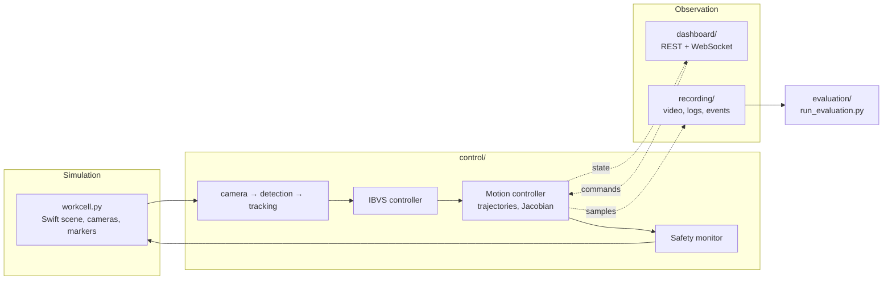

# UR3e Vision-Guided Robotic Surgical Simulation

**Image-Based Visual Servoing (IBVS) · Swift 3D workcell · safety supervision · live dashboard · automated evaluation**

> **Simulation only.** This project is a robotics engineering study. It is not a medical device, makes no claim of clinical validity, and must not be used for any real procedure. Soft-tissue deformation, contact forces and physiological response are **not** modelled; the scenario is a rigid-body approach motion over a fixed mannequin.

---

## 1. Overview

A complete, end-to-end simulation of a Universal Robots UR3e arm that performs a vision-guided approach to a surgical site on a patient mannequin:

1. The robot starts at a ready pose and plans a straight-line approach to a pre-approach pose.
2. An **eye-in-hand camera** observes colour-coded fiducial markers placed around the selected surgical region.
3. **IBVS** drives the instrument tip to a target pose a few centimetres above the surface, using only image-feature error as feedback.
4. A **safety supervisor** sits between every command and the robot and can scale, block or stop any motion.
5. Everything is observable (web dashboard, synchronised recordings) and measurable (automated evaluation with batch trials and fault injection).

### Key characteristics

| Characteristic | What it means in this project |
|---|---|
| Vision in the loop | Images are rendered, markers detected and tracked, and the controller only sees pixel features (ground-truth depth is the one simulation shortcut, see limitations). |
| Safety with authority | One code path reaches the robot, and the safety monitor filters it. IBVS cannot bypass it. |
| Observable | REST + WebSocket dashboard with robot, vision, safety, patient, log and performance panels. |
| Recorded and reproducible | Videos, robot log and events share one clock (simulation time) and a sample index; runs are headless-capable. |
| Quantitatively evaluated | Accuracy, IBVS, motion, vision, safety, timing and recovery metrics; batch trials with randomised conditions. |
| Verified | 76 automated tests (kinematics, Jacobians, IBVS, vision, safety, API, recording, full procedure). |

---

## 2. Architecture



| Module | Responsibility |
|---|---|
| `workcell.py` | 3D scene (robot, table, mannequin, barriers, zones, cameras, markers), scene update, external-camera rendering |
| `control/` | Transformations, kinematics, Jacobians, trajectories, camera model, detection, tracking, IBVS, motion controller, safety |
| `dashboard/` | Thread-safe shared state, REST API, WebSocket stream, static web frontend |
| `recording/` | Session folders, synchronised video / log / event recording |
| `evaluation/` | Metric computation, reports, aggregation |
| `main.py` | Orchestrates the procedure and the dashboard command loop |
| `run_evaluation.py` | Evaluates sessions or runs headless batch trials |

---

## 3. Procedure

| Phase | What happens | Failure behaviour |
|---|---|---|
| Initializing | Robot is placed at the ready pose (IK + safety check) | Unreachable or unsafe pose aborts the run |
| Planning | Straight-line Cartesian path to the pre-approach pose, IK along the whole path, **every waypoint safety-checked**, goal pose checked | Any unreachable or unsafe waypoint aborts before moving |
| Vision init | Markers detected from the ready pose; desired image features computed from the goal pose | Missing or invisible markers abort the run |
| Positioning | Quintic trajectory followed through the safety filter | A blocked step or e-stop aborts the run |
| Servoing | Closed loop: render → detect → track → IBVS → motion controller | Lost features, safety block or step limit end the run |
| Evaluation | Final pose error, IBVS error, timing, safety counters | – |
| Completed / Aborted | Final state published to the dashboard | – |

---

## 4. Design

### 4.1 Simulation environment
- World frame is the robot base frame; metres, z up. The patient lies along y.
- The mannequin is built from separate body parts (torso, head, arms, legs) with named **surgical regions** (`abdomen`, `chest`); selecting a region moves the markers.
- The UR3e is displayed with its mesh model while all computation uses a DH model of the same arm (the mesh follows the joint angles).
- Safety barriers, a warning sign, a restricted zone around the head and a stand for the external camera complete the cell.
- Swift renders the scene but has no camera, so camera images are generated by projecting 3D markers with a pinhole model and drawing them with OpenCV. The external camera shows a wireframe of the whole cell.

### 4.2 Kinematics and motion
- DH model of the UR3e; forward kinematics; numerical inverse kinematics (Levenberg–Marquardt) with several seeds that returns the solution closest to the current pose, verified by forward kinematics.
- Jacobians in the base, tool and **camera** frames (camera Jacobian via the adjoint of the hand-eye transform). Tests check all three against finite differences.
- Joint-space and Cartesian trajectories with quintic or trapezoidal profiles; Cartesian paths are converted to joint space with IK seeded by the previous solution.
- Damped least-squares pseudo-inverse with adaptive damping near singularities; uniform scaling of joint velocities so the direction of motion is preserved.

### 4.3 Vision pipeline
- **Detection:** colour-coded markers (each hue is an id, so there is no correspondence ambiguity); an unlabeled blob detector is also provided.
- **Tracking:** alpha-beta filter, Hungarian association with a distance gate for unlabeled detections, coasting for short dropouts, explicit loss after a timeout.
- Image noise can be added to test robustness.

### 4.4 IBVS
- Point features in normalised image coordinates, interaction matrix for a moving camera, control law `v = -λ L⁺ (s − s*)` in the camera frame.
- Three interaction-matrix modes (current, desired, mean), damped pseudo-inverse, separate linear and angular speed limits applied by one scale factor, and a pixel tolerance for convergence.
- Needs at least three valid features; fewer ends the run as "lost features".

### 4.5 Safety supervisor
The monitor filters every velocity command, in this order:

1. If an emergency stop is latched, output zero.
2. If the **current** pose is unsafe, latch an e-stop.
3. Limit joint speed and **instrument-tip** speed (including the lever-arm effect of the tool).
4. Predict the next configuration and **refuse the step** if it would violate a rule.
5. Slow down smoothly when the clearance to a zone or boundary is small.

Rules: joint limits with margin, workspace box on the tool tip, restricted zones (links are approximated by segments with a radius), table/floor plane. An e-stop can only be released from a safe pose; a slow **recovery** moves the robot back to the last verified safe pose.

### 4.6 Dashboard
- Flask REST API plus a WebSocket stream (10 Hz) running in background threads, so the simulation keeps the main thread.
- The dashboard **never drives the robot**: commands go into a queue that the main loop polls at every control step (start, pause, resume, stop, e-stop, reset, recording, region).
- Hardening: bound to localhost, JSON-only write endpoints, origin checks on state-changing requests, no `innerHTML` for server data, strict-JSON output (NaN becomes `null`).
- Patient vitals are a labelled random walk for a mannequin; they are not clinical data.

### 4.7 Recording and data model
Each session folder contains:

| File | Content |
|---|---|
| `metadata.json` | Region, goal pose, marker positions, parameters, timing, procedure status |
| `robot_log.csv` | One row per control step: joints, joint velocities, flange position, safety state, IBVS error, feature count, commanded twist, phase |
| `<camera>.mp4` + `<camera>_frames.csv` | Video (in simulation time) and a timestamp for every frame |
| `events.jsonl` | start / pause / resume / stop events |

All files share the simulation time `t_sim` and a `sample` index, so any video frame can be matched with the robot state and the IBVS error.

---

## 5. Evaluation

### 5.1 Method

Evaluation is **offline**: it reads `robot_log.csv` and `metadata.json` only (no simulator, no video), which makes it fast (about one second per session). A batch mode runs headless trials with randomised conditions and can inject faults.

| Category | Metrics | Computed from |
|---|---|---|
| Pose accuracy | Final flange position (mm) and orientation (deg) error against the goal pose | Joint angles → forward kinematics; goal pose from metadata |
| IBVS | Initial / final / mean / RMS / max feature error (px), settling time, decay rate | Tracked feature error per step |
| Motion | Approach deviation from the straight line (max, RMS), path-length ratio, peak joint and tool speed, peak acceleration | Flange position and joint velocities |
| Vision | Detection rate and error (px) against the exact marker projection, tracking availability | Frames re-rendered from recorded joints; feature count |
| Safety | Samples per safety state, violation events, safe fraction | Per-step safety state |
| Performance | Simulated and wall-clock time, loop rate, real-time factor, phase durations, video frames | Metadata and phase column |
| Recovery | Recovery success rate | Batch trials with injected e-stops |

**Verdict:** a session is successful when the procedure converged, the final flange pose is within **5 mm** and **2°** of the goal, and there was no safety stop. These thresholds are engineering acceptance limits chosen for this project, not clinical requirements.

**Batch trials** randomise the region (alternating), tool yaw (±10°) and image noise (0–2 grey levels). With `--faults p`, a fraction `p` of the trials gets an emergency stop at a random servoing frame; the evaluation then releases the e-stop (the robot returns to the last safe pose), restarts the procedure, and counts the trial as recovered if it converges.

**Design note: noise-aware convergence.** The feature error used for IBVS is measured on tracked, noisy features, so it plateaus at about 1.5–1.7 px around a 1.5 px tolerance while the true pose error is already about 1 mm. A first version of the evaluator judged convergence on the last logged sample and reported only 30–40 % success for runs that had all converged. The evaluator now uses the procedure status stored in the session metadata, and for older sessions a 10-sample average with a 25 % band.

### 5.2 Results

All figures come from runs on the author's MacBook Pro, headless. They are simulation results (see 5.3).

**Reference run** (one session, no image noise)

| Metric | Value |
|---|---|
| Final position error | 0.62 mm |
| Final orientation error | 0.10° |
| Final IBVS error | 1.51 px (tolerance 1.5 px) |
| IBVS settling time | 7.8 s |
| Simulated duration | 10.8 s |
| Safety stops | 0 |

**Batch of 10 trials** (seed 0, alternating regions, yaw ±10°, noise 0–2 grey levels)

| Metric | Value |
|---|---|
| Procedures converged | 10 / 10 |
| Final position error | mean 0.85 mm (std 0.14, range 0.57–1.09) |
| Final orientation error | mean 0.14° (std 0.03, max 0.19°) |
| Final IBVS error | mean 1.60 px (max 1.72 px) |
| Simulated duration | 10.6–12.0 s (mean 11.2 s) |
| Safety stops | 0 |
| Wall-clock time per trial | 6.9–8.0 s |

**Fault injection** (10 trials, 30 % planned faults, seed 0)

| Metric | Value |
|---|---|
| Trials with an injected emergency stop | 3 |
| Pose when the stop occurred | 55–71 mm from the goal (mid-approach) |
| Recovery success rate | 3 / 3 (e-stop released, procedure restarted and converged) |
| Remaining trials converged | 7 / 7 |

### 5.3 Interpretation and caveats
- At the working distance of about 0.18 m with this camera, **one pixel corresponds to about 0.5 mm**, which matches the observed millimetre-level pose error: accuracy is bounded by the IBVS tolerance and the depth estimate.
- The results are optimistic compared with a physical system: depth is the simulation's ground truth, the camera and hand-eye transform are perfectly calibrated, the kinematic model equals the controller model, and there is no latency, backlash or tracking-error dynamics.
- One machine, one random seed and small sample sizes: the numbers describe this implementation, not statistical performance.
- Not measured: tool-tip error (the flange is logged), minimum clearance to zones (not logged), tracking error against the reference trajectory (replaced by the straight-line deviation).

---

## 6. Verification

| Test file | Tests | Covers |
|---|---|---|
| `tests/test_kinematics.py` | 26 | Transformations, FK/IK round trips, joint limits, base/tool/camera Jacobians vs finite differences, trajectory profiles and path following |
| `tests/test_ibvs.py` | 18 | Interaction matrix vs finite differences, IBVS convergence in three modes, limits, lost features, camera model, detection, tracking |
| `tests/test_safety.py` | 14 | Zones, limits, speed scaling, blocked motion, latched e-stop, release rules, recovery |
| `tests/test_integration.py` | 18 | REST API validation and hardening, recording synchronisation, controller with safety, layout reachability, full headless procedure, stop and e-stop handling |

---

## 7. Limitations and future work

**Not modelled:** soft tissue, contact forces, instrument–tissue interaction, patient motion, physiology.

**Simplifications:** links are drawn and checked as segments with a fixed radius; no self-collision or mesh-level collision; the workspace limit applies to the tool tip only; markers instead of natural features; no occlusion in rendered images; the simulation provides true depth.

**Future work:**
- Estimate depth (pose-from-markers, ArUco) instead of using ground truth.
- Log the reference trajectory and the clearance to enable tracking-error and clearance metrics.
- Mesh-based collision checking and self-collision.
- Calibration-error, latency and joint-backlash models, then re-run the evaluation.
- Hardware-in-the-loop with a real UR3e through its network interface.

---

## 8. Project structure

```
.
├── main.py                  procedure + dashboard command loop
├── workcell.py              3D scene, cameras, markers
├── run_evaluation.py        evaluation entry point
├── control/                 kinematics, jacobian, transformations, trajectory,
│                            camera, feature_detection, feature_tracking, ibvs,
│                            motion_controller, safety
├── dashboard/               api/ (server, routes, websocket), data/, frontend/
├── recording/               recorder, camera_capture, session_manager
├── evaluation/              accuracy, performance, reports
├── tests/                   76 automated tests
├── recordings/              generated sessions (git-ignored)
├── requirements.txt
├── LICENSE.md
└── references.md
```

---

## 9. Quick start

```bash
python main.py --check                                      # verify the layout is reachable
python main.py                                              # Swift + dashboard (http://127.0.0.1:5000)
python main.py --headless --once --no-dashboard --record    # fast headless run, saved to recordings/
python run_evaluation.py --batch 10 --faults 0.3            # trials + evaluation + recovery test
pytest -q                                                   # automated tests
```

`requirements.txt` was exported from the author's macOS environment: it contains macOS-only `pyobjc-*` packages and course packages that this project does not use. On other platforms install the packages the code imports: `numpy`, `scipy`, `pandas`, `matplotlib`, `opencv-python`, `roboticstoolbox-python`, `spatialmath-python`, `swift-sim`, `spatialgeometry`, `ir-support`, `Flask`, `websockets`, `pytest` (Python 3.12).

---

## 10. License, references, acknowledgements

- Code: MIT License, see [LICENSE.md](LICENSE.md). Third-party packages keep their own licences.
- Methods, standards and software: see [references.md](references.md).
- The UR3e mesh model comes from `ir-support`, the UTS Industrial Robotics (41013) support package; it is installed from PyPI and not redistributed here.
- Parts of the code and documentation were developed with the assistance of an AI assistant (Claude, Anthropic) and were reviewed and tested by the author.